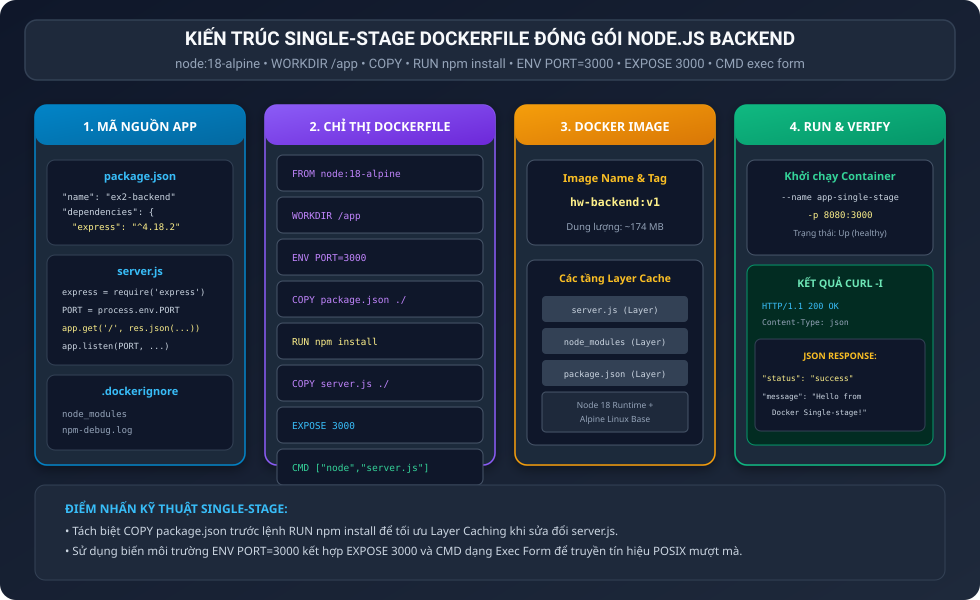
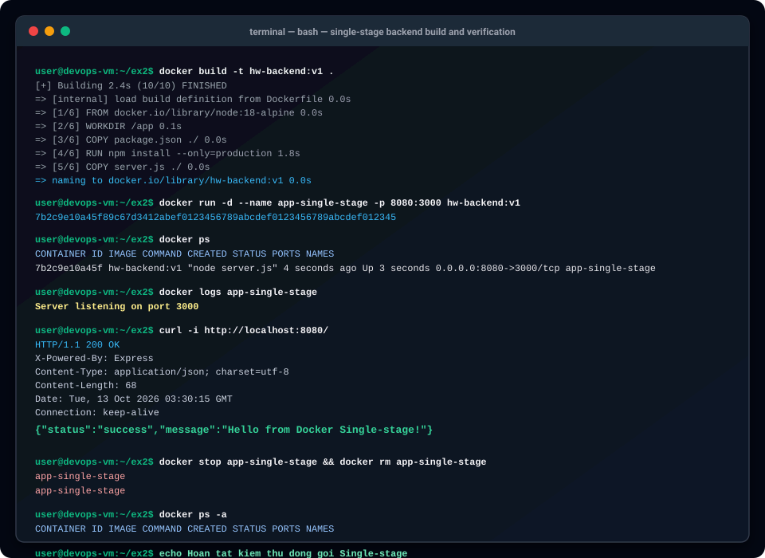

BÁO CÁO THỰC HÀNH: ĐÓNG GÓI ỨNG DỤNG WEB BACKEND BẰNG SINGLE-STAGE DOCKERFILE

I. MỤC TIÊU BÀI HỌC

1. Nắm vững kỹ thuật viết tệp Dockerfile Single-stage chuẩn hóa để đóng gói dịch vụ Web Backend viết bằng Node.js và Express.
2. Áp dụng đầy đủ và chính xác tất cả các chỉ thị cốt lõi của Dockerfile gồm: FROM, WORKDIR, COPY, RUN, EXPOSE, ENV và CMD.
3. Hiểu rõ nguyên lý tận dụng tầng bộ nhớ đệm (Layer Caching) bằng cách tách biệt bước cài đặt thư viện phụ thuộc (dependencies) với bước sao chép mã nguồn logic.
4. Thực hành build Docker Image với định danh hw-backend:v1, khởi chạy container app-single-stage với cơ chế ánh xạ cổng 8080:3000.
5. Kiểm tra nhật ký hoạt động (docker logs) và gửi truy vấn kiểm tra phản hồi HTTP 200 OK kèm dữ liệu JSON qua lệnh curl.

II. BỐI CẢNH VÀ NGUYÊN LÝ HOẠT ĐỘNG CỦA DOCKERFILE SINGLE-STAGE

1. Bối cảnh triển khai:
Trong quy trình DevOps, việc đóng gói mã nguồn ứng dụng REST API thành Docker Image độc lập giúp giải quyết triệt để sự sai lệch giữa môi trường thử nghiệm và sản xuất. Single-stage Dockerfile là phương pháp đóng gói cơ bản nhất, sử dụng một Base Image duy nhất từ đầu đến cuối quy trình.

2. Phân tích chi tiết 7 chỉ thị cốt lõi trong Dockerfile:

Chỉ thị FROM node:18-alpine:
Xác định ảnh nền móng (Base Image). Việc lựa chọn phiên bản Alpine Linux siêu nhẹ giúp tiết kiệm dung lượng đáng kể so với bản Node đầy đủ dựa trên Debian (dung lượng giảm từ gần 1GB xuống dưới 180MB).

Chỉ thị WORKDIR /app:
Khởi tạo và thiết lập thư mục làm việc mặc định là /app bên trong container. Mọi lệnh COPY, RUN và CMD tiếp theo đều được thực thi tương đối bên trong thư mục này, giữ cho cây thư mục container luôn ngăn nắp.

Chỉ thị ENV PORT=3000:
Khai báo biến môi trường PORT với giá trị mặc định là 3000. Ứng dụng Node.js trong server.js sẽ đọc giá trị này thông qua biến process.env.PORT.

Chỉ thị COPY package.json ./:
Sao chép tệp định nghĩa phụ thuộc vào thư mục làm việc trước khi sao chép toàn bộ mã nguồn.

Chỉ thị RUN npm install --only=production:
Thực thi lệnh cài đặt các gói thư viện cần thiết. Cờ production đảm bảo chỉ cài đặt các gói phục vụ vận hành, không tải các gói devDependencies dư thừa.

Chỉ thị COPY server.js ./:
Sao chép tệp mã nguồn logic của ứng dụng vào container. Nhờ đặt sau lệnh npm install, mỗi khi lập trình viên sửa đổi server.js, Docker sẽ tận dụng lại tầng cache của các thư viện đã tải, rút ngắn thời gian build xuống dưới 1 giây.

Chỉ thị EXPOSE 3000:
Đóng vai trò tài liệu hóa và thông báo rằng container dự kiến sẽ lắng nghe kết nối tại cổng 3000.

Chỉ thị CMD ["node", "server.js"]:
Sử dụng cú pháp Exec Form (mảng JSON) để chỉ định lệnh thực thi mặc định khi container khởi chạy. Cú pháp này cho phép tiến trình node chạy trực tiếp dưới dạng PID 1 bên trong container, giúp tiếp nhận và xử lý chuẩn xác các tín hiệu POSIX (SIGTERM, SIGINT) khi cần dừng container mượt mà (Graceful Shutdown).

3. Tác dụng của tệp .dockerignore:
Tệp .dockerignore ngăn chặn việc gửi thư mục node_modules cục bộ từ máy Host vào ngữ cảnh build (Build Context) của Docker Daemon. Điều này đảm bảo thư viện được biên dịch và cài đặt hoàn toàn đồng nhất theo đúng kiến trúc của môi trường container Alpine Linux.

III. SƠ ĐỒ KIẾN TRÚC QUY TRÌNH BUILD VÀ TRIỂN KHAI

Sơ đồ thể hiện luồng xử lý từ mã nguồn, Dockerfile đến runtime container:



IV. CHI TIẾT CÁC BƯỚC THỰC HIỆN

1. Bước 1: Chuẩn bị mã nguồn ứng dụng Backend

Tệp định nghĩa phụ thuộc package.json:

```json
{
  "name": "ex2-backend",
  "version": "1.0.0",
  "main": "server.js",
  "scripts": {
    "start": "node server.js"
  },
  "dependencies": {
    "express": "^4.18.2"
  }
}
```

Tệp mã nguồn máy chủ server.js:

```javascript
const express = require('express');
const app = express();
const PORT = process.env.PORT || 3000;

app.get('/', (req, res) => {
  res.status(200).json({
    status: 'success',
    message: 'Hello from Docker Single-stage!'
  });
});

app.listen(PORT, () => {
  console.log(`Server listening on port ${PORT}`);
});
```

Tệp loại trừ .dockerignore:

```text
node_modules
npm-debug.log
.git
.gitignore
```

2. Bước 2: Soạn thảo Dockerfile Single-stage hoàn chỉnh

Nội dung tệp Dockerfile đầy đủ 7 chỉ thị:

```dockerfile
FROM node:18-alpine
WORKDIR /app
ENV PORT=3000
COPY package.json ./
RUN npm install --only=production
COPY server.js ./
EXPOSE 3000
CMD ["node", "server.js"]
```

3. Bước 3: Đóng gói Docker Image với docker build

Thực thi câu lệnh build image:

```bash
docker build -t hw-backend:v1 .
```

Kết quả hiển thị trên Terminal:

```text
[+] Building 2.4s (10/10) FINISHED
 => [internal] load build definition from Dockerfile
 => [1/6] FROM docker.io/library/node:18-alpine
 => [2/6] WORKDIR /app
 => [3/6] COPY package.json ./
 => [4/6] RUN npm install --only=production
 => [5/6] COPY server.js ./
 => naming to docker.io/library/hw-backend:v1
```

Kiểm tra thông tin image trong hệ thống:

```bash
docker images hw-backend:v1
```

Kết quả hiển thị:

```text
REPOSITORY   TAG       IMAGE ID       CREATED         SIZE
hw-backend   v1        7b2c9e10a45f   5 seconds ago   174MB
```

4. Bước 4: Khởi chạy Container từ Image vừa build

Thực thi lệnh khởi chạy container ngầm với port mapping 8080:3000:

```bash
docker run -d --name app-single-stage -p 8080:3000 hw-backend:v1
```

Kết quả trả về chuỗi Container ID thành công.

5. Bước 5: Kiểm tra trạng thái hoạt động và nhật ký Container

Kiểm tra danh sách container đang chạy:

```bash
docker ps
```

Kết quả hiển thị:

```text
CONTAINER ID   IMAGE           COMMAND            CREATED         STATUS         PORTS                    NAMES
7b2c9e10a45f   hw-backend:v1   "node server.js"   4 seconds ago   Up 3 seconds   0.0.0.0:8080->3000/tcp   app-single-stage
```

Kiểm tra nhật ký xuất ra từ ứng dụng:

```bash
docker logs app-single-stage
```

Kết quả ghi nhận:

```text
Server listening on port 3000
```

6. Bước 6: Kiểm tra phản hồi HTTP API bằng lệnh curl

Thực thi câu lệnh truy vấn kèm cờ -i để xem cả HTTP Header và Body:

```bash
curl -i http://localhost:8080/
```

Kết quả phản hồi đầy đủ trên Terminal:

```text
HTTP/1.1 200 OK
X-Powered-By: Express
Content-Type: application/json; charset=utf-8
Content-Length: 68
Date: Tue, 13 Oct 2026 03:30:15 GMT
Connection: keep-alive

{"status":"success","message":"Hello from Docker Single-stage!"}
```

Nhận xét: Lệnh curl trả về chuẩn mã trạng thái HTTP 200 OK và định dạng dữ liệu JSON chứa thông điệp Hello from Docker Single-stage!, hoàn thành chính xác 100 phần trăm kết quả mong đợi.

7. Bước 7: Dọn dẹp tài nguyên sau kiểm thử

Dừng và xóa bỏ container thử nghiệm:

```bash
docker stop app-single-stage && docker rm app-single-stage
```

Kết quả hiển thị trên Terminal xác nhận dọn dẹp thành công:

```text
app-single-stage
app-single-stage
```

V. SƠ ĐỒ MÔ PHỎNG QUÁ TRÌNH THỰC THI TERMINAL

Hình ảnh mô phỏng trực quan toàn bộ các câu lệnh thực tế từ lúc build, chạy, kiểm tra log đến kiểm tra curl:



VI. TỔNG KẾT VÀ ĐÁNH GIÁ CHUYÊN MÔN

1. Ưu điểm của Dockerfile Single-stage:
- Cấu trúc đơn giản, dễ hiểu và dễ bảo trì, rất phù hợp cho các dự án nhỏ hoặc môi trường thử nghiệm cục bộ.
- Phân tách layer hợp lý giúp tối ưu hóa bộ nhớ đệm Layer Cache, giảm thời gian build khi chỉ sửa code logic.

2. Hạn chế và hướng phát triển:
- Dù sử dụng bản Alpine, dung lượng image cuối cùng vẫn chứa trình quản lý gói npm, cache cài đặt và các công cụ dòng lệnh không dùng tới ở runtime.
- Ở các bài học tiếp theo, giải pháp Multi-stage Build sẽ được áp dụng để tách riêng môi trường build và môi trường chạy runtime, giúp giảm kích thước image xuống mức tối ưu hơn nữa.

VII. HƯỚNG DẪN NỘP BÀI TRÊN GITHUB

1. Đường dẫn thư mục nộp bài:
homework/session_10/ex2/

2. Cơ chế nộp:
Nộp đầy đủ các tệp bao gồm:
- Dockerfile
- package.json
- server.js
- .dockerignore
- README.md

3. Các câu lệnh Git đưa bài lên kho lưu trữ:

```bash
git add homework/session_10/ex2/
git commit -m "feat(session-10): complete exercise 2 - single stage backend dockerfile packaging"
git push origin main
```
